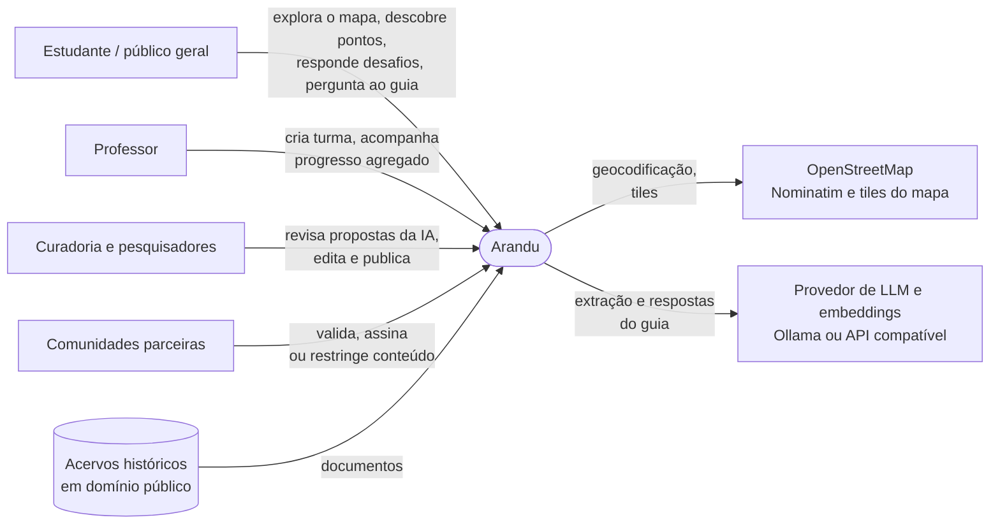
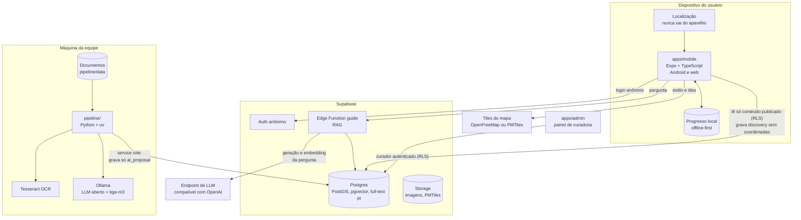
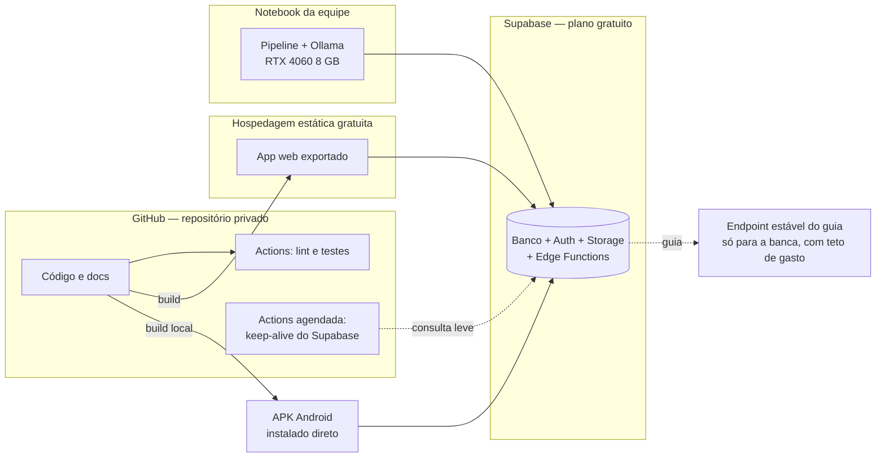

# 01 — Visão geral

## Contexto

Quem usa o Arandu e com quais sistemas externos ele conversa.

## Contêineres

Os blocos que compõem o sistema e como se ligam.

## Implantação no protótipo (custo fixo zero)

Riscos e mitigações dos planos gratuitos estão em [`docs/04-arquitetura-tecnica.md`](../04-arquitetura-tecnica.md#custos-e-confiabilidade-no-protótipo).

## Estado dos componentes

| Componente | Local | Estado |
| --- | --- | --- |
| Esquema do banco | `supabase/migrations/20261112000000_initial_schema.sql` | 🟡 Escrito, não testado |
| Políticas RLS | `supabase/migrations/20261112000100_rls.sql` | 🟡 Escrito, não testado |
| Testes de RLS e do índice do guia | `supabase/tests/database/rls.test.sql` | 🟡 Escrito, não testado |
| Seed do piloto | `supabase/seed/` | ⚪ Planejado (depende do conteúdo da equipe) |
| App Expo | `apps/mobile/` | ⚪ Planejado |
| Painel de curadoria | `apps/admin/` | ⚪ Planejado |
| Pipeline: configuração e cliente de IA trocável | `pipeline/arandu_pipeline/config.py`, `llm.py` | 🟢 Implementado (10 testes com endpoint simulado; embeddings verificados contra o Ollama real com `bge-m3`; chat ainda sem modelo escolhido) |
| Pipeline: etapas ingest → publish | `pipeline/arandu_pipeline/` | ⚪ Planejado (M4) |
| Guia (Edge Function) | `supabase/functions/guide/` | ⚪ Planejado |
| CI e keep-alive | `.github/workflows/` | ⚪ Planejado |

## Princípios que a arquitetura garante

| Princípio (CLAUDE.md) | Onde é garantido |
| --- | --- |
| A IA propõe, pessoas decidem | Pipeline só grava `ai_proposal` e pontos em `proposta_ia`; só a curadoria muda status (RLS) |
| Guia só responde com conteúdo validado | Triggers impedem indexar pontos não publicados ou restritos; ver [04 — Fluxos](04-fluxos.md#guia-rag) |
| Privacidade de estudantes | Proximidade calculada no aparelho; `discovery` não tem coordenadas; usuário anônimo |
| Conteúdo restrito nunca exibido nem enviado ao LLM | RLS filtra `sensitivity <> 'restrito'`; trigger apaga os chunks do ponto |
| Custo mínimo | Modelos abertos locais, planos gratuitos, provedor trocável por `.env` |
