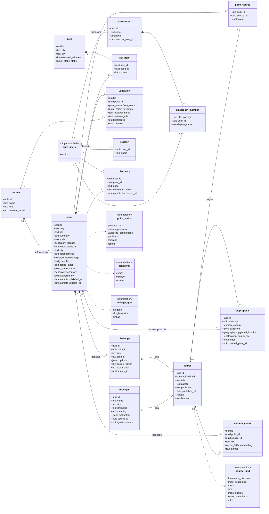

# 02 — Modelo de dados

Estado: 🟢 **Implementado** (migrations aplicadas e testadas localmente). Fonte de verdade: [`supabase/migrations/`](../../supabase/migrations/). A descrição de produto de cada entidade está em [`docs/05-modelo-de-dados.md`](../05-modelo-de-dados.md).

## Diagrama de classes (UML)

Agrupado em quatro áreas: **conteúdo** (o que o app mostra), **curadoria** (o que leva o conteúdo à publicação), **uso** (o que o usuário faz) e **guia** (índice para o RAG).

Notas de leitura:

- `*--` (composição): apagar o ponto apaga seus desafios, validações e chunks (`on delete cascade`).
- `auth_users` é a tabela `auth.users` do Supabase. As colunas `user_id` e `teacher_user_id` guardam esse id, sem chave estrangeira formal.
- `discovery` **não tem coordenadas** do usuário: só `user_id`, `point_id`, modo e resultado.

## Diferenças em relação à doc 05

| Mudança | Motivo | Decisão |
| --- | --- | --- |
| Tabela `curator` | RLS precisa distinguir curadoria de usuário anônimo | [decisoes.md](../decisoes.md) |
| `trail.status` | Trilha em rascunho não pode aparecer no app | [decisoes.md](../decisoes.md) |
| `content_chunk.point_id` obrigatório | Todo chunk pertence a um ponto publicado | [decisoes.md](../decisoes.md) |
| `content_chunk.fts` (full-text `portuguese`) | Busca híbrida e fallback sem embeddings | [decisoes.md](../decisoes.md) |
| `unlock_radius_m` entre 10 e 1000 | Evita raio inválido | — |

## Triggers e funções

| Nome | Tipo | O que faz |
| --- | --- | --- |
| `point_before_update` | trigger `before update` em `point` | Atualiza `updated_at`; preenche `published_at` ao entrar em `publicado` |
| `content_chunk_guard` | trigger `before insert/update` em `content_chunk` | Recusa chunk de ponto não publicado ou restrito |
| `point_purge_chunks` | trigger `after update of status, sensitivity` em `point` | Apaga os chunks quando o ponto sai de `publicado` ou vira `restrito` |
| `is_curator()` | função `security definer` | O usuário atual está em `curator`? |
| `is_point_public(id)` | função `security definer` | Ponto publicado e não restrito? |
| `is_source_public(id)` | função `security definer` | Fonte ligada a ponto, desafio ou topônimo publicado? |
| `is_classroom_member(id)` | função `security definer` | O usuário atual é membro da turma? |

## Índices

| Índice | Uso |
| --- | --- |
| `point_location_idx` (GiST) | Pontos próximos e por área |
| `point_status_idx` | Filtro de publicados |
| `content_chunk_fts_idx` (GIN) | Busca full-text em português |
| `content_chunk_embedding_idx` (HNSW, cosseno) | Busca vetorial do guia |
