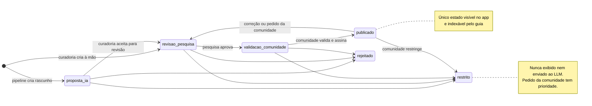
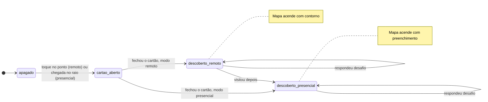

# 03 — Ciclos de vida

## Validação de um ponto

Estado: 🟢 enum e triggers implementados e testados; ⚪ transições no painel planejadas (M5).

### Efeitos de cada estado

| Estado | Visível no app | Indexável pelo guia | Efeito automático no banco |
| --- | --- | --- | --- |
| `proposta_ia` | Não | Não | — |
| `revisao_pesquisa` | Não | Não | Ao voltar de `publicado`: chunks apagados |
| `validacao_comunidade` | Não | Não | — |
| `publicado` | Sim (se `sensitivity <> 'restrito'`) | Sim | `published_at = now()` |
| `rejeitado` | Não | Não | Chunks apagados |
| `restrito` | Não | Não | Chunks apagados |

Toda transição deve gerar uma linha em `validation` (quem, papel, quando, comentário). Isso será feito pelo painel (M5); ⚪ ainda não há trigger que obrigue.

### `status = restrito` e `sensitivity = restrito`

Os dois existem e ambos bloqueiam o conteúdo:

- `sensitivity` descreve **a natureza do conteúdo** (`aberto`, `cuidado`, `restrito`). Pode ser marcada em qualquer etapa.
- `status = restrito` descreve **a decisão de retirada** no fluxo de validação.

As RLS e os triggers verificam os dois. Um ponto `publicado` com `sensitivity = restrito` não aparece no app nem no guia.

O mesmo ciclo vale para `toponym` e `trail` (campo `status`).

## Descoberta de um ponto (por usuário)

Estado: ⚪ Planejado (M2–M3).

- O ponto acende ao **fechar o cartão**, com ou sem resposta ao desafio (leitura faz parte do ciclo).
- Exploração remota libera **todos** os pontos publicados e **nunca pede permissão de localização**.
- Remoto e presencial valem o mesmo na meta semanal e nas áreas acesas; a diferença é só visual e no rótulo em texto ("Descoberto à distância" / "Visitado").
- Persistência: `discovery.mode` (`remota` ou `presencial`) e `discovery.challenge_correct`.

### Revelação no mapa (atual)

| Zoom | Camada | Como acende |
| --- | --- | --- |
| 0 a 6 | Estados (IBGE) com pontos | Opacidade = 0,55 × descobertos ÷ publicados; contorno tênue a 0% |
| 5 a 10 | Municípios (IBGE) com pontos | Idem |
| todos | Pontos | Cinza (a descobrir), anel ocre (remota), ocre cheio (presencial) |

Dentro da cidade (zoom ≥ 10) não há áreas, só pontos.

### Revelação hierárquica por H3 (substituída)

Cada descoberta acende a célula do lugar (H3 res. 9) e aumenta o brilho das áreas que contêm o ponto:

| Nível | H3 | Área média | Zoom em que aparece | Brilho |
| --- | --- | --- | --- | --- |
| Lugar | 9 | ≈ 0,1 km² | todos | contorno (remota) ou preenchimento (presencial) |
| Bairro | 7 | ≈ 5 km² | 8 a 13 | proporção descobertos ÷ publicados na área |
| Cidade | 4 | ≈ 1.770 km² | 4,5 a 9 | idem |
| Estado/região | 2 | ≈ 87 mil km² | 0 a 5,5 | idem |

Áreas com pontos ainda não descobertos têm contorno tênue. Os hexágonos aproximam os níveis; não são limites administrativos.
- Errar o desafio não bloqueia: o ponto acende de qualquer forma; acertar dá um selo extra.
- O usuário pode apagar o próprio progresso (LGPD).
