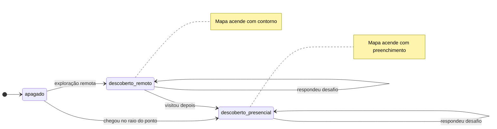

# 03 — Ciclos de vida

## Validação de um ponto

Estado: 🟢 enum e triggers implementados e testados; ⚪ transições no painel planejadas (M5).

### Efeitos de cada estado

| Estado | Visível no app | Indexável pelo guia | Efeito automático no banco |
| --- | --- | --- | --- |
| `proposta_ia` | Não | Não | — |
| `revisao_pesquisa` | Não | Não | Ao voltar de `publicado`: chunks apagados |
| `validacao_comunidade` | Não | Não | — |
| `publicado` | Sim (se `sensitivity <> 'restrito'`) | Sim | `published_at = now()` |
| `rejeitado` | Não | Não | Chunks apagados |
| `restrito` | Não | Não | Chunks apagados |

Toda transição deve gerar uma linha em `validation` (quem, papel, quando, comentário). Isso será feito pelo painel (M5); ⚪ ainda não há trigger que obrigue.

### `status = restrito` e `sensitivity = restrito`

Os dois existem e ambos bloqueiam o conteúdo:

- `sensitivity` descreve **a natureza do conteúdo** (`aberto`, `cuidado`, `restrito`). Pode ser marcada em qualquer etapa.
- `status = restrito` descreve **a decisão de retirada** no fluxo de validação.

As RLS e os triggers verificam os dois. Um ponto `publicado` com `sensitivity = restrito` não aparece no app nem no guia.

O mesmo ciclo vale para `toponym` e `trail` (campo `status`).

## Descoberta de um ponto (por usuário)

Estado: ⚪ Planejado (M2–M3).

- Persistência: `discovery.mode` (`remota` ou `presencial`) e `discovery.challenge_correct`.
- Errar o desafio não bloqueia: o ponto acende de qualquer forma; acertar dá um selo extra.
- O usuário pode apagar o próprio progresso (LGPD).
