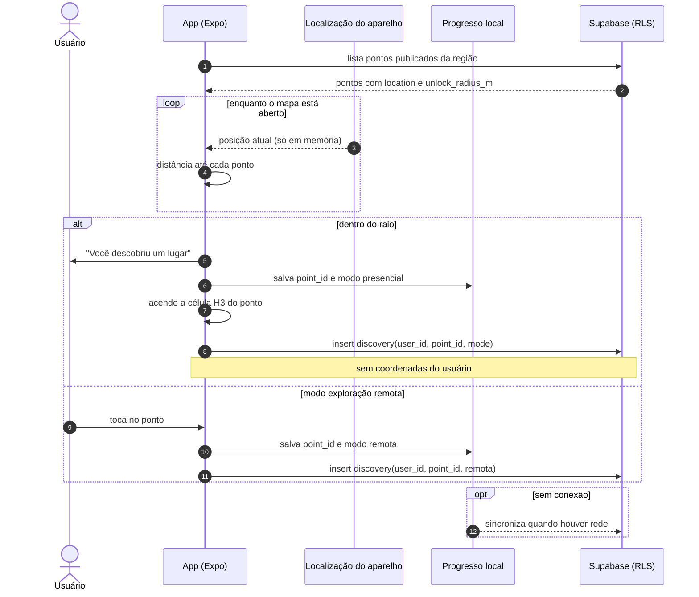
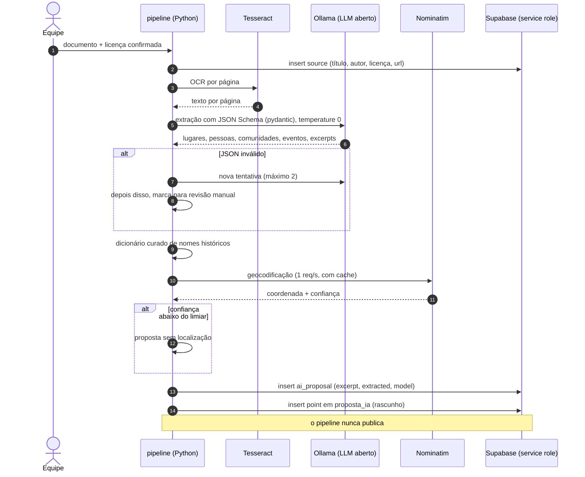
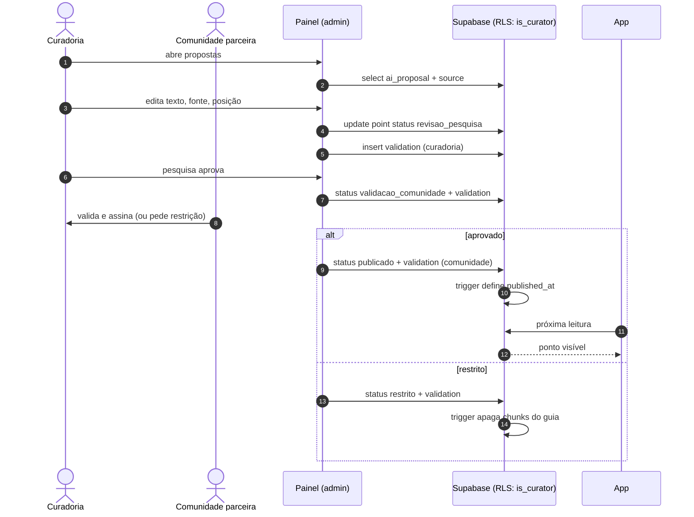
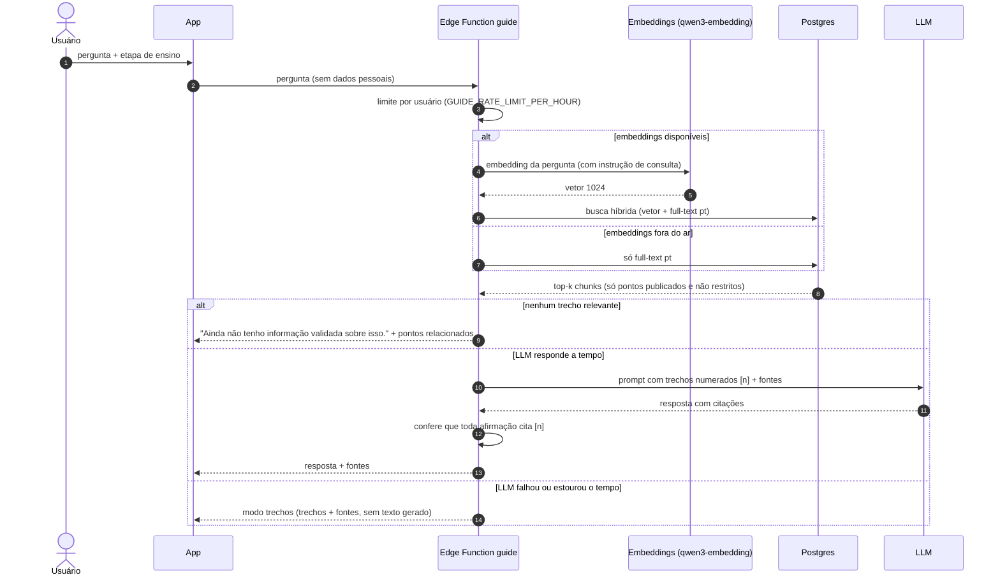

# 04 — Fluxos

Diagramas de sequência dos quatro fluxos centrais.

## Descoberta por proximidade

Estado: ⚪ Planejado (M2). Regra: **a posição do usuário nunca sai do aparelho.**

## Pipeline "revelar": de documento a proposta

Estado: ⚪ Planejado (M4). Roda na máquina da equipe, com modelos abertos.

## Curadoria: da proposta à publicação

Estado: ⚪ Planejado (M5).

## Guia (RAG)

Estado: ⚪ Planejado (M6). Inclui as duas degradações seguras.

