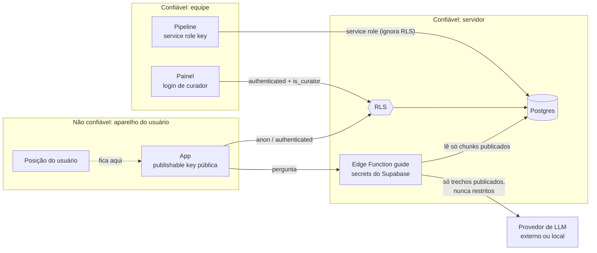

# 05 — Segurança e privacidade

## Fronteiras de confiança

Regras:

- O app só conhece a **publishable key** (`sb_publishable_…`, sucessora da anon key), que é pública por design; a proteção é feita pelas RLS.
- A **service role key** fica só no pipeline e no backend do painel, nunca em variáveis `EXPO_PUBLIC_*`.
- Endereço, modelo e chave do LLM ficam nos **secrets do Supabase**, nunca no app.
- O LLM só recebe trechos que passaram pelo `content_chunk_guard`: conteúdo restrito nunca chega a ele.

## Matriz de acesso (RLS)

Estado: 🟢 Implementado (13 testes pgTAP passando). Fonte: [`20261112000100_rls.sql`](../../supabase/migrations/20261112000100_rls.sql).

| Tabela | `anon` | Usuário (anônimo autenticado) | Curador | Service role |
| --- | --- | --- | --- | --- |
| `point` | Ler publicados e não restritos | Igual a `anon` | Tudo | Tudo |
| `challenge`, `point_source` | Ler se o ponto é público | Igual | Tudo | Tudo |
| `source` | Ler se ligada a conteúdo público | Igual | Tudo | Tudo |
| `toponym`, `trail` | Ler `publicado` | Igual | Tudo | Tudo |
| `trail_point` | Ler se trilha e ponto públicos | Igual | Tudo | Tudo |
| `discovery` | — | Ler, criar, alterar, apagar **as próprias**; criar só para ponto público | Ler | Tudo |
| `classroom` | — | Professor: CRUD da própria; membro: ler | Ler | Tudo |
| `classroom_member` | — | Membros e professor leem; membro pode sair | Ler | Tudo |
| `validation`, `ai_proposal`, `partner` | — | — | Tudo | Tudo |
| `content_chunk` | — | — | Ler | Tudo (com trigger de guarda) |
| `curator` | — | — | Ler | Tudo |
| `admin_area` (IBGE, dado público) | Ler | Ler | Ler | Tudo |
| Views `published_point`, `area_with_points`, `state_outline`, `municipality_outline` | Ler (só publicados, via RLS de quem pergunta) | Igual | Igual | Tudo |

"—" = sem acesso. Sem política, o Postgres nega por padrão.

Cobertura de testes: [`supabase/tests/database/rls.test.sql`](../../supabase/tests/database/rls.test.sql) (13 casos: leitura anônima, descobertas próprias, curador, guarda e limpeza do índice do guia).

## Dados do usuário (LGPD)

| Dado | Onde fica | Sai do aparelho? |
| --- | --- | --- |
| Posição GPS | Memória do app | **Nunca** |
| Pontos descobertos, modo, acerto | Aparelho + `discovery` | Sim, só `point_id`, modo e acerto |
| Identidade | Usuário anônimo do Supabase Auth | Só o id anônimo |
| Apelido na turma | `classroom_member.display_name` | Sim (apelido, nunca nome completo) |
| Pergunta ao guia | Edge Function | Sim, sem dados pessoais; não armazenada por padrão |
| E-mail | Apenas curadores e professores, quando necessário | Sim |

Direitos: o usuário pode apagar as próprias descobertas (`discovery_own_delete`) e sair de uma turma (`classroom_member_leave`).

## Segredos

| Segredo | Onde fica | Nunca em |
| --- | --- | --- |
| `SUPABASE_SERVICE_ROLE_KEY` | `.env` do pipeline e do admin | App, repositório |
| `LLM_API_KEY`, `EMBEDDING_API_KEY` | `.env` do pipeline; `supabase secrets` | App, repositório |
| `EXPO_PUBLIC_*` | Código do app (público) | — (não pode conter segredo) |

O `.gitignore` bloqueia `.env*`, exceto `.env.example`. O repositório é privado nesta fase.
