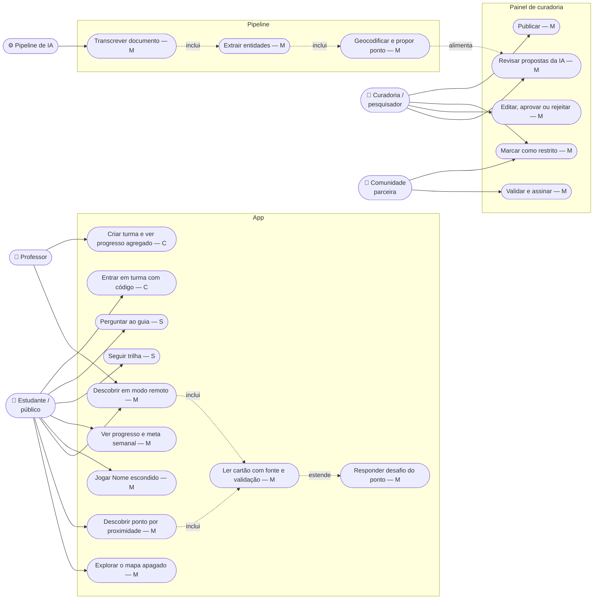

# 06 — Casos de uso

Prioridade conforme [`docs/02-escopo-mvp.md`](../02-escopo-mvp.md): **M** = Must, **S** = Should, **C** = Could.

## Atores

| Ator | Autenticação | Pode | Não pode |
| --- | --- | --- | --- |
| Estudante / público | Anônimo | Explorar, descobrir, responder, perguntar | Ver rascunhos; enviar localização |
| Professor | Anônimo ou login mínimo | Criar turma, ver progresso agregado | Ver dados individuais identificáveis |
| Curadoria / pesquisador | Login de curador (`curator`) | Editar, mudar status, publicar | Publicar sem fonte |
| Comunidade parceira | Pela curadoria (painel no futuro) | Validar, assinar, restringir, pedir retirada | — (pedido tem prioridade) |
| Pipeline de IA | Service role | Criar `source`, `ai_proposal`, rascunhos | Publicar |
